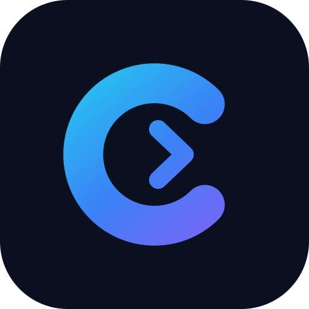

  

# Cody Code

**Cody Code** est un éditeur de code moderne, basé sur le code open source de VS Code
([Code - OSS](https://github.com/microsoft/vscode)), avec sa propre identité visuelle et son assistant « Cody Assistant ».

> 🚧 Projet en construction. La liste complète et à jour des fonctionnalités est dans [`FEATURES.md`](FEATURES.md).

## Objectifs
- Offrir **toutes les fonctionnalités** de VS Code (éditeur, terminal, Git, débogage, extensions…).
- Un **design propre à Cody Code** (thème sombre, barre latérale, panneau Cody Assistant).
- Des extensions via **[Open VSX](https://open-vsx.org)** (magasin libre).
- Aucune télémétrie Microsoft.

## État du projet
Voir [`FEATURES.md`](FEATURES.md) (fonctionnalités testées ✅) et [`Reprise.md`](Reprise.md) (avancement du travail).

## Compiler et tester
La compilation se fait sur GitHub Actions (voir `.github/workflows/cody-build.yml`) : installation, compilation, lancement de la version web et test automatique d'ouverture / écriture / sauvegarde d'un fichier.

## Licence et crédits
Cody Code est distribué sous licence **MIT**, comme le code dont il est issu.
Il est basé sur [Code - OSS](https://github.com/microsoft/vscode), © Microsoft Corporation, licence MIT. Voir [`LICENSE.txt`](LICENSE.txt) et [`NOTICE.md`](NOTICE.md).

« Visual Studio Code » et son logo sont des marques de Microsoft. Cody Code n'est ni affilié à Microsoft ni approuvé par Microsoft.
